# La Laisse Dog Walker: Nicolas's beta space

Branch: `fm/dogcare-nicolas-lalaisse-r1`\
PR: pending (opened by the no-mistakes pipeline).\
Deployment: **not performed**. Installing or updating `nicolasdelalaissedogcare.plusdefun.ch` needs a separate captain go. No message was sent to Nicolas.

## Delivered

- Brand: the space now reads **La Laisse Dog Walker**, with `La Laisse` in both phone headers (one line at 390 px) and the tagline "Promenades canines · Batignolles · depuis 2011". The web address and instance id are unchanged.
- Palette: black and white like his wordmark, with one accent, the Sol de Mayo gold `#F6B40E`. Near-black on gold is 9.5:1 and on white 17.4:1 (WCAG AA). Celeste and sun brown are gone.
- Mark: an original dog-head silhouette (`DC_BRAND_MARK=dog`). His logo file was not copied. `DC_BRAND_LOGO` takes his real file later and serves it at `/brand/logo`.
- Content file `deploy/dogcare-nicolas.content.json` (`DC_BRAND_CONTENT`): hero, three services (balade en meute en forêt, promenade en ville, je viens chercher et je ramène votre chien), "Tarif à convenir" on every card, a Boutique / alimentation line for Dibaq Sense (no prices), a first-person about text signed Nicolás Salaya Macri, and a Contact section with phone, email, Instagram @lalaisse.dogwalker and Avis Google.
- Every service books as a walk, so his client request form only offers walks.
- Gallery: no photos of his are bundled. The page invites him to add his own to each dog's album; Adine-Sophie's media stay blocked (404).
- Docs: `docs/second-instance.md` covers the new variables and the content file. `deploy/dogcare-nicolas.env.example` carries the new configuration.

## Sources and choices

- All copy comes from `~/BrainShared/raw/private/nicolas-la-laisse-public-profile-2026-10-24.md`, with the WhatsApp Business profile winning over older sources: 2011 (not 2012), 14 years, 3 000+ walks, forest walks Tuesday to Friday, mornings and some afternoons, and his approach (confiance, stabilité, sécurité). Group size (5 to 6 dogs), pick-up area (Paris 17e, Neuilly, Levallois-Perret), Patagonia, the certificat de capacité and pack energy come from the older Aladom listing; nothing newer contradicts them.
- "Quelques notions d'éducation" and "j'ai toujours vécu parmi les animaux" were checked on the live Aladom page, since the raw note did not quote them.
- The old 12 €/h rate is not shown anywhere. The "chaque après-midi, environ 2 h" schedule and the Bois de Boulogne label were dropped because the newer profile says forest walks on Tuesday to Friday mornings and some afternoons.
- Google reviews: `…EEB0` (Instagram) and `…EEBM` (WhatsApp) both redirect to the same Maps place (`0x498f0c4487bf0b9`) on 2026-10-24. The file uses `…EEBM`, the newer one.
- Owner name is shown as "Nicolás", as he writes it.
- Balades: the model has no named places, only track names and spots, so no Bois de Boulogne preset was added.
- French copy scored 0 ("clean") on `sloptrim-fr.py`.

## Verification

- Default instance (Le Bus des Toutous): rendered dashboard plus the welcome page in all five languages, and the anonymous public page, are byte-identical before and after (DOM dump diff). Default CSS/JS/HTML responses still equal the checked-in files (`test_default_brand_is_served_unchanged`).
- `tests.test_brand_instance`: 9 browser tests passed, including two new ones for the La Laisse content and the logo/invalid-content fallback.
- Full acceptance suite: `node --test tests/*.js` 105 passed; `unittest discover -s tests` 486 tests OK (4 skipped).

## Screenshots (390 × 844)

| | Before | After |
|---|---|---|
| La Laisse welcome | 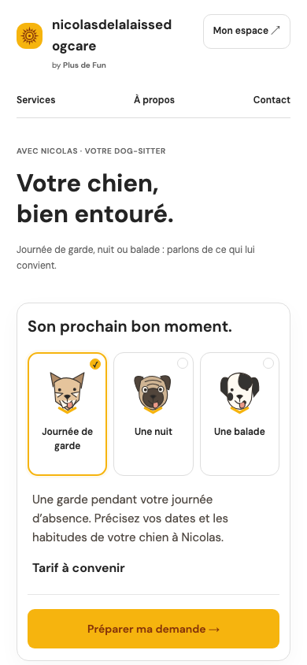 | 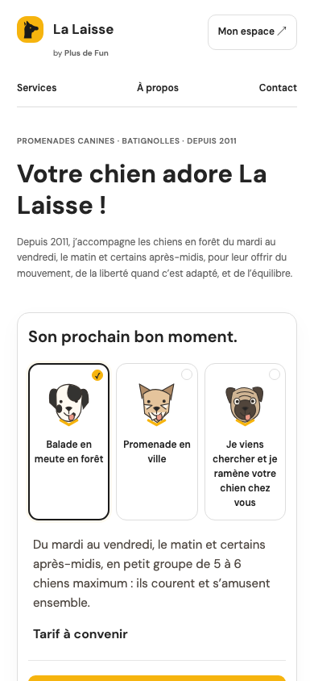 |
| La Laisse services | 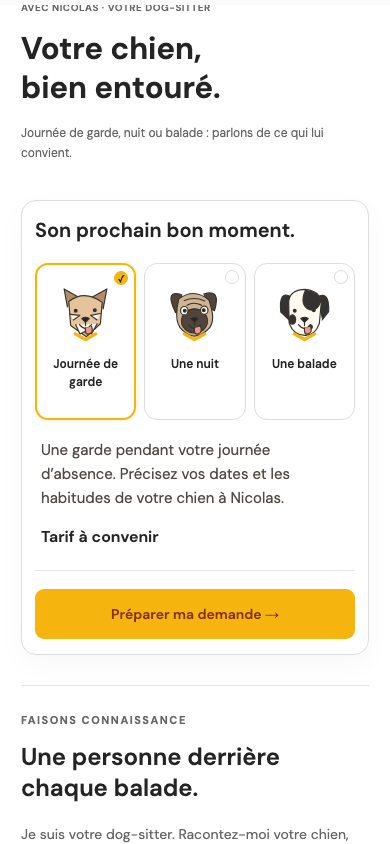 | 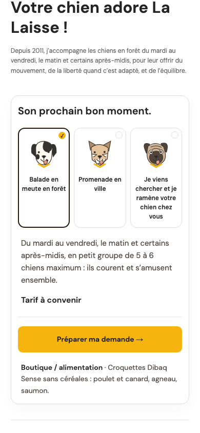 |
| La Laisse about | 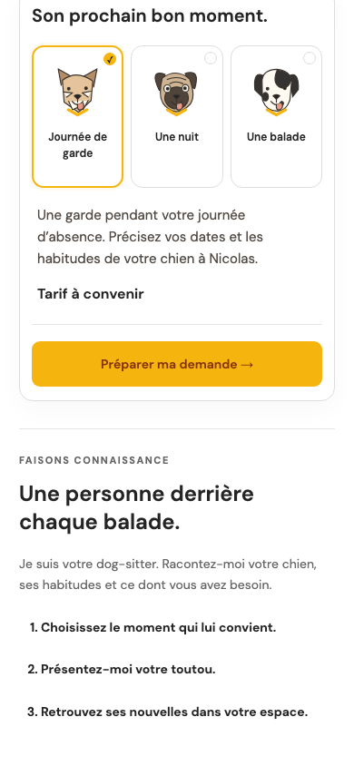 | 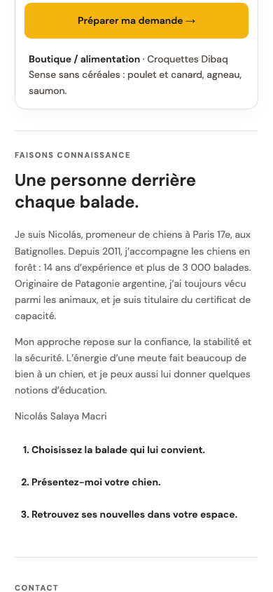 |
| La Laisse contact |  | 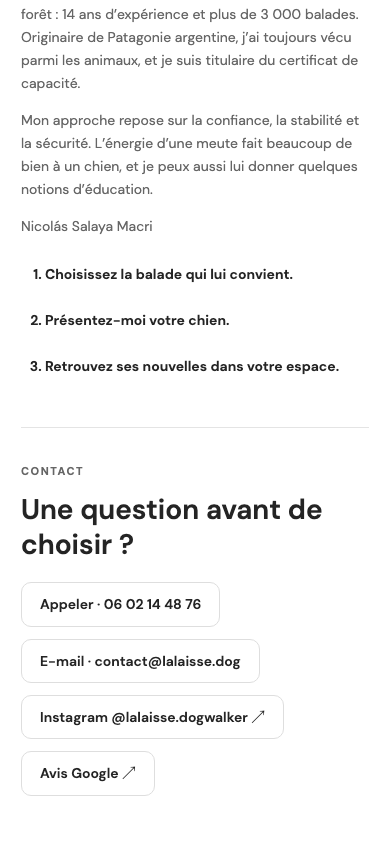 |
| La Laisse dashboard | 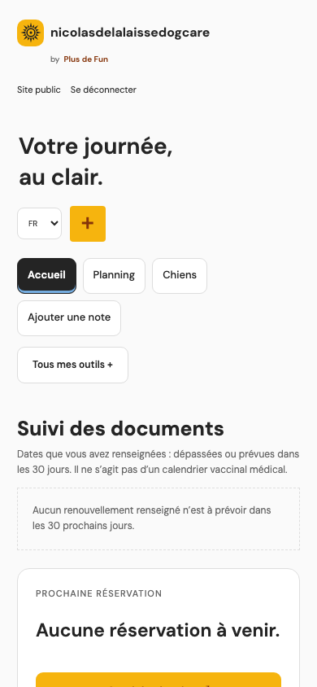 | 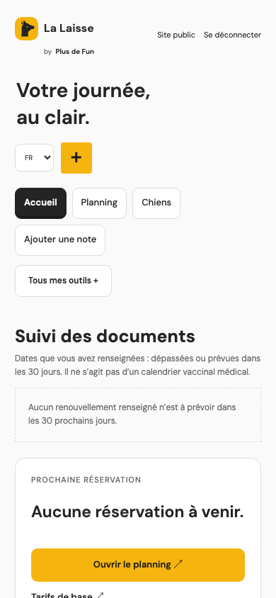 |
| Default welcome | 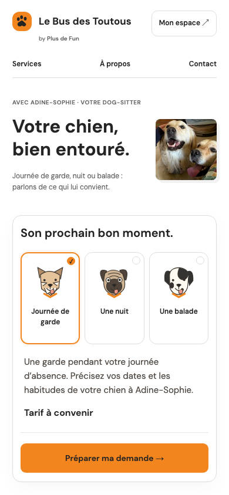 |  |
| Default services | 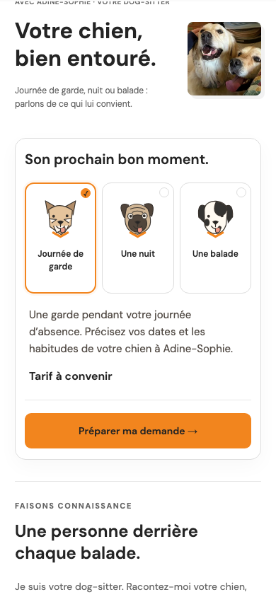 | 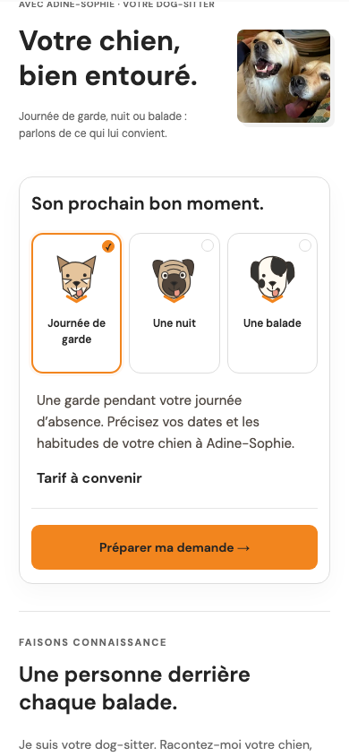 |
| Default about | 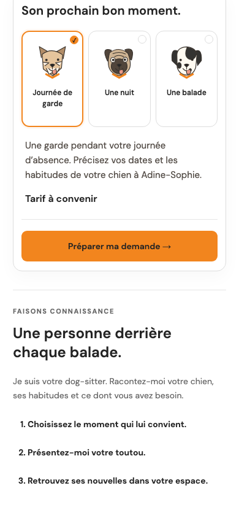 |  |
| Default contact |  |  |
| Default dashboard |  | 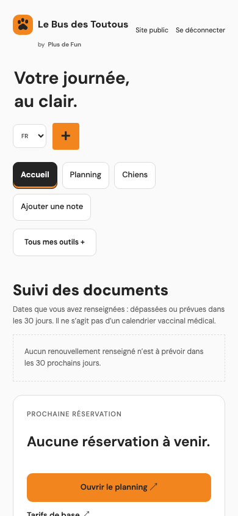 |

Whole La Laisse page: [after-nicolas-welcome-full-390.png](after-nicolas-welcome-full-390.png).

## Open for the captain

- Go to install or update the instance on the server.
- Nicolas's logo file and permission to use it, for `DC_BRAND_LOGO`.
