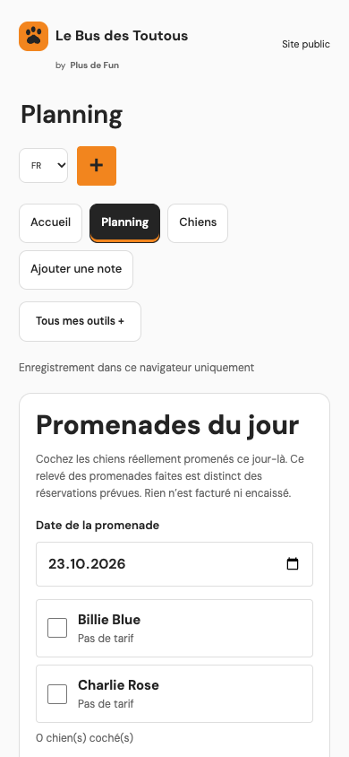
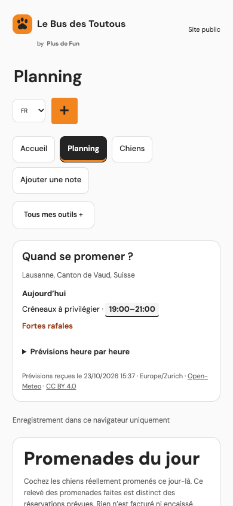
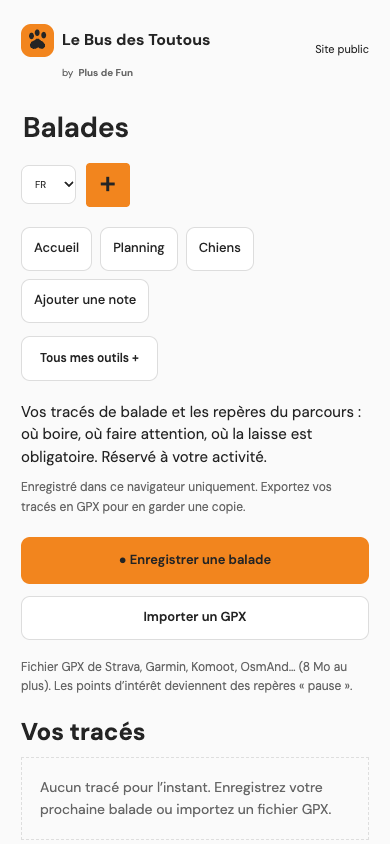
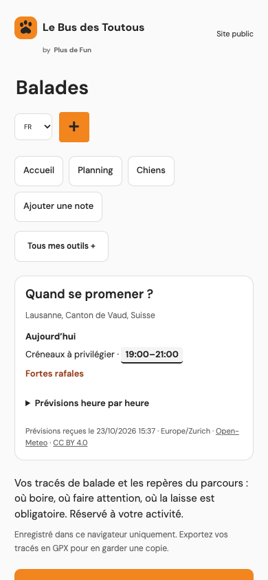

# DogCare walk weather

Branch: `fm/dogcare-walk-weather-r1`\
PR: [#16 — walk-weather forecasts](https://github.com/GoldenSis/dog-care-brain/pull/16).\
Deployment: **not performed**; dogcare.plusdefun.ch requires a separate captain go.

Implementation and review fixes are published in the PR. The first no-mistakes run reached `checks-passed`; this report records that outcome separately from the earlier implementation evidence.

## Delivered

- Planning and Balades share one keyless Open-Meteo forecast request/cache. Today is shown in the business timezone; tomorrow appears from 18:00.
- Hourly air temperature, precipitation probability/amount, thunderstorm codes 95–99, UV and gusts; preferred two-hour windows and explicit weather warnings.
- Owner Settings: city search or one-shot position, save/remove location, heat threshold (default 25 °C), asphalt explanation. Static and account persistence remain separate; carers read, owners write.
- French default plus English, Italian, German and Spanish. Failed refreshes retain timestamped data and suppress suggestions; without useful data, the weather strip is empty and the page stays usable.
- Only search text/language or business coordinates/weather parameters go to Open-Meteo. No dog/client/track/care records enter those requests; cookies and referrer are omitted.

The authoritative behaviour, product heuristics, storage/API contract and licence/release boundary are in [Daily workflows](../../docs/daily-workflows.md#walk-weather).

## Verification

### Pipeline validation after review fixes

- Run `01M5MHBX79K6VZ0NKZE3SD8M81` reached `checks-passed` on published commit `c6ca0d4`. The reported GitHub check was CodeRabbit: passed. No merge or deployment was performed.
- Review fixed three misses: heat-threshold saves now retain shared forecast requests/cache/retry timing; repainting preserves hourly scroll and keyboard focus; all five languages use precipitation wording that also covers snow. The original interaction failures were reproduced before verifying the fixes.
- Firstmate explicitly retained **Remove location** on 2026-10-23 so users can clear their stored location. Review finding R4 was accepted on that basis.
- The focused weather model, API/static-boundary checks and all **12 weather browser journeys** passed after the fixes. The test phase also passed **10 product scenarios**, including real Open-Meteo requests, business-local 18:00/midnight transitions with a surviving booking draft, cache isolation, timeout recovery, and recording/saving/reloading a walk during forecast failure. Simulated clock, weather and device-position inputs are identified in the PR evidence.
- Documentation, syntax and whitespace checks passed. The pipeline test phase did **not** rerun the full acceptance suite; its earlier full-suite result is recorded below.

### Implementation baseline

These are the recorded results from implementation commit `2f17f20`, before the gate's review fixes in `a16d38b`; they are not validation results for the current revision. The expanded regression coverage is described in [Daily workflows](../../docs/daily-workflows.md#walk-weather).

- **105 Node tests passed** (`node --test tests/*.js`), including seven new model/translation checks and rejection of malformed forecast timestamps; all frontend JavaScript syntax checks and `git diff --check` passed.
- **Four new browser journeys passed** across static and account modes: settings search/position, reload, failed-save retry, one shared forecast request, five locales, 390/1440 widths, stale-cache and no-cache failure, and usable Planning during failure.
- **63 relevant API tests passed**, including six new settings checks covering roles, tenant/revision guards, strict validation, rollback and additive initialization.
- **Full Python/browser acceptance suite passed:** `uv run --python 3.12 --with playwright==1.61.0 python -m unittest discover -s tests -v` ran 476 checks: 472 passed, four skipped. Three skips are account-only scenarios excluded in static mode; the fourth is the existing HEIC conversion check because `heif-convert` is not installed. The deployment media runtime gate must verify HEIC separately. The final run includes all four weather browser journeys. An earlier run overlapped a timing correction and was discarded.
- Live Open-Meteo city search and forecast returned HTTP 200 in Chrome. Both pages reused the single forecast request. Chrome console: no errors; page overflow: false at 390 and 1440 px.
- Independent frontend review found one issue: Open-Meteo rain/probability/gust timestamps describe the preceding hour. Fixed the interval alignment for cards, warnings and suggestions; the added boundary regression and the reviewer's targeted recheck passed. The separate reviewer used the same model family; no model-diversity claim.
- Real-phone geolocation/permission behaviour and deployment are not verified. Browser geolocation acceptance uses synthetic coordinates.

## Before / after evidence for the PR body

All captures use chrome-devtools-axi. Before and live-after captures are from the static app at 390 × 844. The labelled fixture captures simulate 18:00 and heat/storm/heavy rain to show tomorrow and warning behaviour; they are not a claim about actual Lausanne weather. These implementation-stage captures predate the review fixes and retain the earlier rain wording; current labels use precipitation terminology.

| Surface | Before | After |
| --- | --- | --- |
| Planning, 390 px |  |  |
| Balades, 390 px |  |  |

Additional evidence: [hourly details, live](after-hourly-390.png), [saved settings](after-settings-390.png), [warnings and tomorrow, simulated](after-warnings-fixture-390.png), [desktop, simulated](after-planning-fixture-1440.png).

The [PR body](https://github.com/GoldenSis/dog-care-brain/pull/16) embeds both before/after pairs using repository image URLs, plus fresh post-fix Planning, Balades, hourly, Settings, desktop, warning and offline screenshots uploaded by the pipeline. No merge or deployment has been performed.
